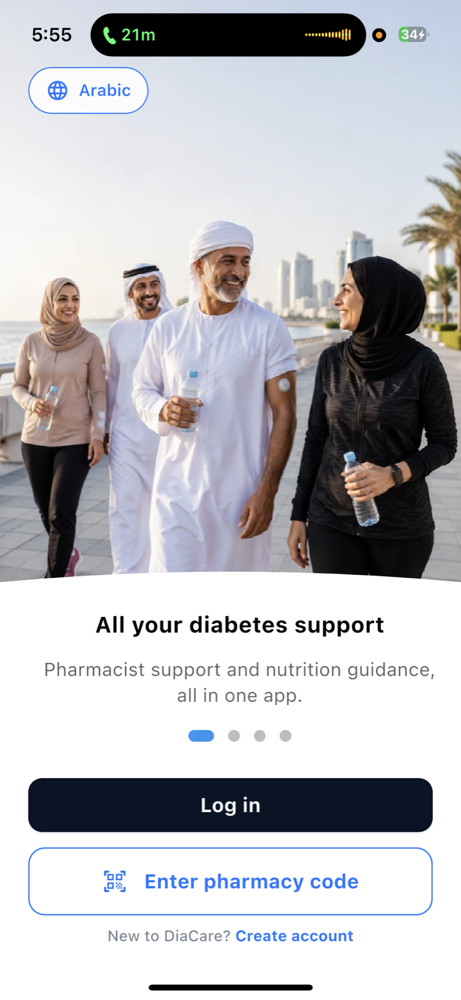

# DiaCare — Meal Planning, Logging & Grocery Workflows

DiaCare is a bilingual Flutter application. This case study focuses on connecting meal selection, food logging and grocery preparation, including what happens when a portion changes, a request stalls or an account changes.

**[Project report](https://tansari2004.github.io/tarik-alansari-portfolio/diacare.html)** · **[Technical evidence](docs/verification.md)** · **[Product website](https://diacare.health/)**

> This is a documentation repository. The application source, backend configuration and user data are private. It cannot be built or deployed from this repository, and it does not contain application CI. The verification below refers to a local development checkout, not a certified production release.

## My contribution

I founded RIWAQ For Software LLC and developed DiaCare's Flutter interfaces, shared meal-log data layer and photo-analysis workflow. The work described here spans meal selection, logging, portion handling and grocery preparation. DiaCare also includes medication tracking and professional messaging; those features are outside this report's verification scope.

## The problem

A meal plan is useful only if someone can carry it into daily actions: review a meal, record the portion actually eaten, and prepare the ingredients. Separate screens can disagree when users edit entries or a request fails. My engineering focus was keeping those workflows coherent and providing recovery paths.

## Implementation decisions

| Decision | Practical consequence | Evidence boundary |
|---|---|---|
| Planner and manual logger share a meal-log repository | Entries feed the same log state rather than separate screen-local copies | Source review and selected repository/UI tests; not a complete device journey |
| Preserve base/canonical nutrients and portion size | Edits can recalculate from a reference instead of repeatedly scaling an already adjusted total | Source review; portion-conversion tests do not establish nutrient accuracy |
| Keep unavailable optional nutrients nullable | Missing fibre or sodium is distinguishable from a measured zero | Data-model review |
| Share one deadline across photo-analysis stages | A stalled stage has a bounded interface wait | Direct deadline tests |
| Allow cancellation while handling late completion/errors | The interface can stop waiting safely | Direct cancellation tests; remote work may continue |
| Separate normal logout from account switching | Returning-account retention and different-account cleanup have different responsibilities | Mocked local-state tests and source-contract checks; not a Firebase rules audit |
| Keep grocery estimates separate from confirmed prices | An estimated catalogue total is not presented as a guaranteed purchase price | Source review and selected grocery tests |

See [architecture and workflow notes](docs/architecture.md) for the component boundaries and [verification notes](docs/verification.md) for exact test references and limitations.

## Product preview

  

This is an onboarding screenshot, not evidence of the meal workflows or their reliability. The [portfolio report](https://tansari2004.github.io/tarik-alansari-portfolio/diacare.html) includes meal-plan and grocery interfaces with example data.

## Verification and current scope

On October 24, 2026, the selected local runs passed **81 tests and failed three home-screen tests**. This is not an all-green application audit. The six-file focused suite passed **22 tests** covering photo cancellation, shared deadlines, portion conversions, local account cleanup, identity ownership and normal logout. Some checks execute behaviour with mocked storage; others inspect source contracts. The [verification note](docs/verification.md) distinguishes them and records the additional workflow checks from this audit.

Food suggestions and portions require user confirmation. Grocery prices are estimates. This case study does not establish recognition accuracy, clinical outcomes, measured user benefits, production access-rule enforcement or the behaviour of every released build. External service handling depends on the configured provider.

## Takeaway and next step

The less visible work was keeping state and recovery behaviour consistent across screens. The next step is to test complete plan-to-log-to-grocery tasks with users and on real devices, including account transitions and interrupted requests, before claiming improved completion time or usability.

## Contact

[LinkedIn](https://www.linkedin.com/in/tarik-alansari) · [GitHub](https://github.com/Tansari2004) · [DiaCare](https://diacare.health/)

## Rights

Copyright © 2026 Tarik Alansari and RIWAQ For Software LLC. All rights reserved. See [LICENSE](LICENSE).
