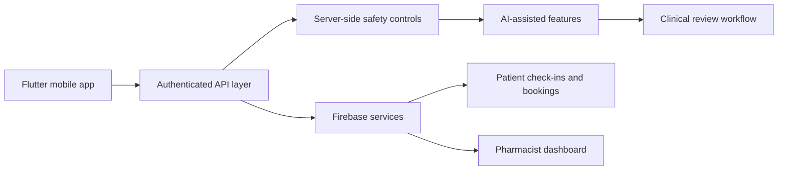

# DiaCare — Diabetes Management Platform

DiaCare is a bilingual diabetes and weight-management platform built to make ongoing support easier to access. The product combines patient check-ins, appointment booking, pharmacist workflows and GLP-1 monitoring in one mobile experience.

**Live product:** [diacare.health](https://diacare.health)

> This repository is a public product and engineering case study. DiaCare's production source code, credentials and patient data are private and are not included.

## My role

I founded RIWAQ For Software LLC and led the software development of DiaCare. My work included product design, Flutter development, Firebase integration, backend APIs, bilingual features and healthcare-safety controls.

## The problem

Diabetes and weight-management support often spans several disconnected touchpoints: medication follow-up, nutrition guidance, check-ins, appointment scheduling and communication with a pharmacist. DiaCare brings those workflows into one platform while keeping clinical review and clear escalation paths in the process.

## Product capabilities

- Bilingual English and Arabic experience
- Patient onboarding and account access
- Diabetes and weight-management check-ins
- Appointment booking and pharmacist support
- Pharmacist-facing dashboards
- GLP-1 monitoring workflows
- AI-assisted features with physician review and server-side safety controls

## Product preview

  

The screen shows the mobile onboarding experience and its focus on combined pharmacist and nutrition support. No patient data is shown.

## Technical architecture

### Technology choices

| Area | Technology | Why it fit |
|---|---|---|
| Mobile client | Flutter / Dart | One codebase for a consistent mobile experience |
| Authentication and data | Firebase / Firestore | Managed authentication and real-time application data |
| Service integration | REST APIs | Clear separation between the client and server-side logic |
| Delivery | Git and GitHub Actions | Version control and repeatable development workflows |
| Cloud services | Google Cloud | Managed hosting and backend services |

## Safety and privacy approach

- Health-related features use server-side controls instead of relying only on the mobile client.
- AI-assisted outputs are designed to support, not replace, qualified healthcare professionals.
- Physician review and referral pathways are part of the product model.
- This case study contains no credentials, patient records or production source code.

## Product development

DiaCare was shaped by feedback from patients and healthcare professionals. RIWAQ also secured a pharmacy partnership with a signed revenue-sharing agreement for pharmacist support and paid consultations, and worked with Jordan's Ministry of Health to clarify guidance around medication support, referrals and healthcare services.

## What I learned

- Healthcare software needs explicit safety boundaries and human review.
- Bilingual support is a product workflow decision, not just text translation.
- Pharmacist and patient interfaces need different information priorities.
- Public case studies can explain engineering decisions without exposing proprietary code or sensitive data.

## Contact

- Product: [diacare.health](https://diacare.health)
- LinkedIn: [linkedin.com/in/tarik-alansari](https://www.linkedin.com/in/tarik-alansari)
- GitHub: [github.com/Tansari2004](https://github.com/Tansari2004)

## Rights

Copyright © 2026 Tarik Alansari and RIWAQ For Software LLC. All rights reserved. See [LICENSE](LICENSE).
