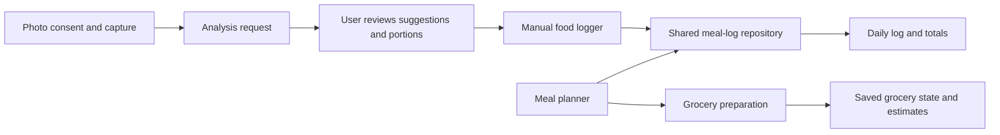

# Architecture and workflow notes

This is a sanitised description of the local application's meal workflows. It excludes production endpoints, credentials, security rules, backend configuration and user records. It is not a deployment specification.

## Client and shared state

The Flutter planner and manual logger use a shared meal-log repository. A log entry retains the meal identity, timestamp, portion, base/canonical nutrient values and optional nutrient information. The UI observes shared entries instead of maintaining an independent manual-log record list.

Serving edits use reference values and the chosen portion. Nullable optional nutrients preserve the distinction between unavailable information and zero. Neither the data structure nor portion conversion validates the underlying food catalogue's nutrient accuracy.

The diagram shows logical responsibilities. The grocery list is not a transactionally synchronised view of every log edit, and this diagram does not imply that logging a meal purchases or removes its ingredients.

## Photo workflow

Consent precedes sending a food photo for analysis. The user reviews suggestions and portions before logging; manual entry remains available. One deadline is shared across asynchronous analysis stages. Cancellation ends the interface's wait and handles late results/errors, but does not prove cancellation at the remote provider.

## Persistence and accounts

Firebase authentication, application data services and backend APIs support the wider application; local preferences and secure storage also participate in client state. Not every operation is routed through a single REST gateway.

Normal sign-out retains returning-account local data while changing session state and stopping private reminders. A different account triggers account-scoped cleanup and ownership checks. Approved device settings and owner-bound retention metadata can survive cleanup. These are client behaviours: they do not substitute for server-side authorisation or demonstrate complete data isolation.

## Grocery preparation

The grocery workflow combines plan/profile information with catalogue items and saved list state. It distinguishes estimated prices from user-corrected prices and exposes loading, retry and save-failure states. Selected tests cover these paths; a production store-price feed and guaranteed checkout totals are not established.

## Verification boundary

See [verification notes](verification.md). This public repository contains documentation and an onboarding asset, not the application, automated app tests or production deployment workflows. The notes report a local run of private code with test doubles; they are not independently reproducible application evidence from this repository alone.
